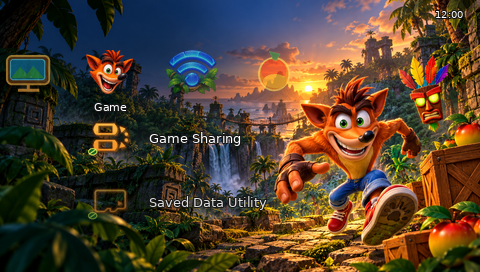

# Crash Bandicoot — PSP Theme

Unofficial fan project credited to **Amir Saeid Dehghan**, featuring Crash, Aku Aku, a tropical wallpaper, eight category icons and 31 redesigned first- and second-level icons. The submenu shapes are derived from the PTF Studio sample and recoloured; the sample's focus graphics remain. Names, characters and marks belong to their respective owners. This project is not endorsed by Sony or the rights holders.

**Hardware status:** the file was built and structurally extracted, but not tested on a physical PSP or an emulator. Installation and appearance are unverified. Intended models are PSP-1000, 2000, 3000, Go and Street; functionality varies by model and firmware. The file declares firmware 6.20; compatibility with earlier firmware is unknown. PSP Go-specific entries may use firmware fallback icons.

## Installation

Download [Crash_Bandicoot_PSP_Theme.ptf](dist/Crash_Bandicoot_PSP_Theme.ptf). Copy it to `PSP/THEME/` on the PSP storage, creating the folder if needed; safely disconnect and choose **Settings → Theme Settings → Theme**. On PSP Go, use the storage containing the file. If it is not listed, check the folder and firmware. If it renders incorrectly, select another theme. Standard PTF themes do not require custom firmware; this file still needs on-device testing.

## Previews

[Settings](screenshots/settings_simulation.png) · [Photo](screenshots/photo_simulation.png) · [Music](screenshots/music_simulation.png) · [Video](screenshots/video_simulation.png) · [Network](screenshots/network_simulation.png) · [Wallpaper](screenshots/wallpaper.png) · [PSP Go concept](screenshots/psp_go_concept_mockup.png)

These are simulations composited from extracted resources, **not hardware screenshots**. Real fonts, positions and focus rendering may differ. The device mockup is an AI-generated concept, not an accurate product photograph. The high-resolution art is flattened and has no editing layers.

## Rebuild

Install Python 3 and Pillow (`python -m pip install Pillow`), then run `python generate_subicons.py` and `python build.py`. The builder uses `base_sample.ptf`, replaces the wallpaper, previews, category and body icons, and retains sample focus assets. Rebuilds matched byte-for-byte in the tested environment; different Pillow or zlib versions may differ. To regenerate simulations, extract the PTF with [LibPSPThemes](https://github.com/GeofrontTeam/LibPSPThemes) using `python ptf.py -c <path-to-ptf>`, then run `python make_previews.py`.

## Validation

The 574,744-byte PTF was extracted by LibPSPThemes. The wallpaper measured 480 × 272; eight category images measured 64 × 48; 29 first-level bodies measured 48 × 48; two second-level bodies measured 32 × 32. All 39 icon bodies had transparency. Two consecutive builds had the same SHA-256; see `SHA256SUMS.txt`. These checks do not prove PSP compatibility, correct focus effects or text readability.

## Project files and credits

`dist/` contains the PTF; `assets/` contains source art and icon PNGs; `base_icons/` contains sample-derived source icons; `base_sample.ptf` is the sample; `build.py` and `generate_subicons.py` build the theme; `screenshots/` contains simulations. The sample and format implementation derive from [PTF Studio](https://github.com/S1implyBlue/PTF-Studio), created by Blue and licensed GPL-3.0; see `COPYING`. LibPSPThemes was used to inspect the output, not bundled. Images were generated using OpenAI's image generator; the mockup device is a concept.
